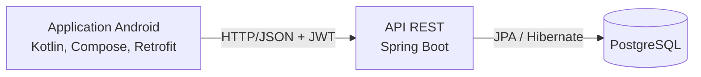
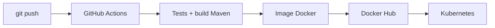

# SmartParking

Application mobile Android de réservation de places de parking, adossée à une API REST Spring Boot et à une chaîne DevOps complète : tests automatisés, conteneurisation, publication d'image et déploiement sur Kubernetes.

L'utilisateur consulte les parkings et leurs places disponibles, réserve une place sur un créneau horaire et gère ses réservations depuis son téléphone.

## Fonctionnalités

**Application mobile**
- Création de compte, connexion et déconnexion
- Liste des parkings avec le nombre de places disponibles
- Détail d'un parking et de ses places
- Réservation d'une place sur un créneau (date, heure, durée)
- Consultation et annulation de ses réservations

**API**
- Authentification par JWT, mots de passe hachés avec BCrypt
- Rôles `USER` et `ADMIN` : la création de parkings et de places est réservée aux administrateurs
- Validation des données reçues
- Disponibilité **calculée** à partir des réservations (détection de chevauchement de créneaux), jamais stockée
- Health checks pour Kubernetes (`/actuator/health`)

## Architecture



L'API est organisée en couches : **Controller** (HTTP), **Service** (règles métier), **Repository** (accès aux données). Les échanges passent par des DTO : les entités ne sont jamais exposées directement.

### Chaîne CI/CD



## Stack technique

| Couche | Technologie | Rôle |
|---|---|---|
| Mobile | Kotlin, Jetpack Compose, Retrofit | Application Android et appels à l'API |
| Backend | Spring Boot 4, Java 21 | API REST et logique métier |
| Sécurité | Spring Security, JWT, BCrypt | Authentification et autorisation par rôle |
| Données | PostgreSQL 16, Spring Data JPA / Hibernate | Persistance |
| Tests | JUnit 5, Mockito | Tests unitaires du service de réservation |
| CI/CD | GitHub Actions | Tests, build, publication de l'image |
| Conteneurs | Docker, Docker Compose | Exécution locale reproductible |
| Registry | Docker Hub | Stockage de l'image du backend |
| Orchestration | Kubernetes | Réplication, configuration, sondes de santé |

## Structure du dépôt

```
Smart-parking/
├── android-app/          Application Android (Kotlin, Compose)
├── backend/              API Spring Boot et Dockerfile
├── k8s/                  Manifests Kubernetes
├── .github/workflows/    Pipeline GitHub Actions
├── docker-compose.yml    Backend + PostgreSQL en local
└── .env.example          Modèle des variables d'environnement
```

## API REST

| Méthode | Endpoint | Accès | Description |
|---|---|---|---|
| POST | `/api/auth/register` | Public | Créer un compte |
| POST | `/api/auth/login` | Public | Se connecter et obtenir un JWT |
| GET | `/api/auth/me` | Connecté | Profil de l'utilisateur courant |
| GET | `/api/parkings` | Public | Lister les parkings (avec `availableSpots`) |
| GET | `/api/parkings/{id}` | Public | Détail d'un parking |
| POST | `/api/parkings` | `ADMIN` | Créer un parking |
| GET | `/api/parkings/{id}/spots` | Public | Lister les places d'un parking |
| POST | `/api/parkings/{id}/spots` | `ADMIN` | Ajouter une place |
| POST | `/api/reservations` | Connecté | Réserver une place |
| GET | `/api/reservations/me` | Connecté | Mes réservations |
| DELETE | `/api/reservations/{id}` | Connecté (propriétaire) | Annuler une réservation |

Codes de retour principaux : `400` données invalides, `401` non authentifié, `403` accès interdit, `404` ressource introuvable, `409` conflit (email déjà utilisé, créneau déjà réservé).

## Démarrage rapide (Docker Compose)

Prérequis : Docker Desktop.

```bash
git clone https://github.com/eyabenmaiz/Smart-parking.git
cd Smart-parking

cp .env.example .env        # puis remplacer les valeurs par vos propres secrets
docker compose up --build
```

L'API répond sur `http://localhost:9090`. Vérification :

```bash
curl http://localhost:9090/actuator/health
```

Les données PostgreSQL sont conservées dans le volume `pgdata`. `docker compose down` arrête les conteneurs sans effacer les données ; `docker compose down -v` supprime aussi le volume.

### Créer un compte administrateur

L'inscription crée toujours un compte `USER`. Pour promouvoir un compte :

```bash
docker exec -it smartparking-postgres psql -U smartparking -d smartparking \
  -c "UPDATE users SET role='ADMIN' WHERE email='votre@email.com';"
```

Reconnectez-vous ensuite : le rôle est inscrit dans le jeton au moment de la connexion.

## Application Android

1. Ouvrir le dossier `android-app/` avec Android Studio.
2. Démarrer l'API (voir ci-dessus), avec au moins un parking et quelques places.
3. Lancer l'application sur un émulateur.

L'émulateur joint le PC hôte avec l'adresse `10.0.2.2` (configurée dans `ApiClient.kt`). Si la connexion échoue, vérifier que le port 9090 est bien publié sur toutes les interfaces et autorisé par le pare-feu, ou utiliser `adb reverse tcp:9090 tcp:9090` avec l'URL `http://localhost:9090/`.

## Déploiement sur Kubernetes

Les manifests sont dans `k8s/` : ConfigMap, Deployment et Service du backend (2 réplicas, sondes de readiness et de liveness), Deployment PostgreSQL avec volume persistant.

```bash
# Secret : créé en ligne de commande, jamais versionné
kubectl create secret generic smartparking-secret \
  --from-literal=POSTGRES_PASSWORD=<mot_de_passe> \
  --from-literal=DB_PASSWORD=<mot_de_passe> \
  --from-literal=JWT_SECRET=<cle_d_au_moins_32_caracteres>

kubectl apply -f k8s/configmap.yaml
kubectl apply -f k8s/postgres.yaml
kubectl apply -f k8s/backend.yaml
kubectl get pods
```

`POSTGRES_PASSWORD` et `DB_PASSWORD` doivent avoir la même valeur.

L'image utilisée est `eya203/smartparking-backend:latest`, publiée automatiquement par le pipeline.

Démonstrations de la réplication et de l'auto-réparation :

```bash
kubectl delete pod <un-pod-backend>            # Kubernetes le recrée
kubectl scale deployment backend --replicas=3  # montée en charge
kubectl scale deployment backend --replicas=2
```

> Le port 9090 ne peut être occupé que par un seul mode à la fois : Docker Compose, backend lancé depuis l'IDE ou Service Kubernetes de type `LoadBalancer`.

## Pipeline CI/CD

À chaque `push` sur `main`, GitHub Actions exécute deux jobs :

1. **build-and-test** : installe Java 21, démarre un PostgreSQL de test, lance `mvn verify` (tests et build), puis vérifie que l'image Docker se construit.
2. **publish** : si les tests réussissent, construit l'image et la publie sur Docker Hub avec deux tags : `latest` et l'identifiant du commit.

Les identifiants Docker Hub sont stockés dans les secrets du dépôt (`DOCKERHUB_USERNAME`, `DOCKERHUB_TOKEN`) et n'apparaissent jamais dans le code.

## Tests

```bash
cd backend
./mvnw test
```

- Tests unitaires du service de réservation (Mockito) : créneau libre, chevauchement, dates incohérentes, annulation par le propriétaire, annulation refusée à un autre utilisateur.
- Test de démarrage du contexte Spring, qui nécessite un PostgreSQL (fourni par le pipeline en CI).

## Sécurité et configuration

- Mots de passe hachés avec BCrypt, jamais renvoyés par l'API.
- API stateless : le serveur ne garde aucune session, ce qui permet de multiplier les réplicas.
- Les secrets (mot de passe de la base, clé JWT) sont fournis par variables d'environnement : fichier `.env` (ignoré par Git) en local, Secret Kubernetes dans le cluster.
- PostgreSQL n'est pas exposée en dehors du réseau Docker.
- Le jeton n'est pas écrit dans les journaux de l'application Android.

## Auteure

Eya Ben Maiz : [GitHub](https://github.com/eyabenmaiz)
